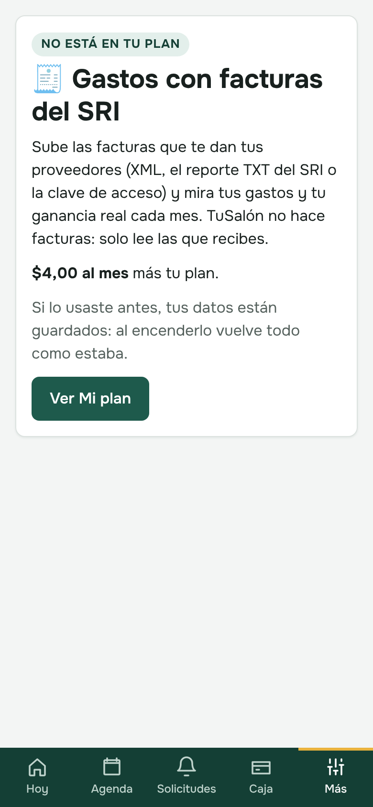
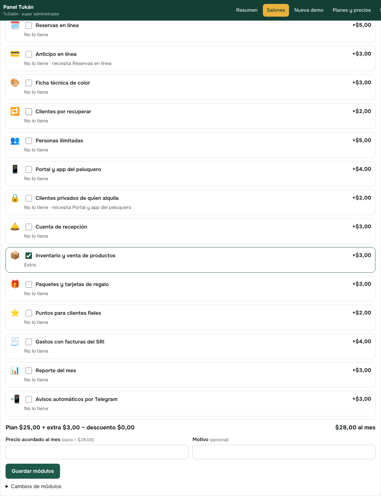

# TuSalón: módulos, Mi plan y demos (guía para el manual y la presentación)

Esta guía se suma al manual (`docs/Manual_TuSalon.pdf`). Explica lo nuevo del 18 de octubre de 2026 en palabras sencillas.

## 1. TuSalón se arma por módulos
Todos los salones tienen la **base**: agenda por sillas y citas, clientes con su historial y cumpleaños, servicios con lo que gana el peluquero,
equipo con los 4 tipos de peluquero (dueño, empleado, porcentaje y alquiler de puesto), las cuentas de cada uno, cobrar, caja y cierre de caja,
horarios, el enlace de cada cita para que el cliente confirme o cancele, y hasta 3 personas que atienden.

Lo demás son **módulos**: cada uno se enciende o se apaga para tu salón y tiene su precio al mes.

| Módulo | Para qué sirve | Al mes |
|---|---|---|
| 🗓️ Reservas en línea | Tu enlace para que los clientes reserven solos; cuenta del cliente, cambiar la hora y fotos | $5 |
| 💳 Anticipo en línea | El cliente paga una parte al reservar (necesita Reservas en línea) | $3 |
| 🎨 Ficha técnica de color | La fórmula de cada tinte con fotos de antes y después | $3 |
| 🔁 Clientes por recuperar | Quién dejó de venir, con el WhatsApp listo | $2 |
| 👥 Personas ilimitadas | Más de 3 personas que atienden | $5 |
| 📱 Portal y app del peluquero | Cada peluquero ve sus citas y lo que gana en su celular | $4 |
| 🔒 Clientes privados de quien alquila | Los clientes propios del que alquila el puesto (necesita el Portal) | $2 |
| 🛎️ Cuenta de recepción | Agenda, cobra y cierra la caja sin ver tus ganancias | $3 |
| 📦 Inventario y venta de productos | Stock, aviso de que se acaba y venta al cobrar | $3 |
| 🎁 Paquetes y tarjetas de regalo | "4 cortes por $50" y tarjetas con código | $3 |
| ⭐ Puntos para clientes fieles | Ganan puntos al pagar y los cambian por descuentos | $2 |
| 🧾 Gastos con facturas del SRI | Sube las facturas que recibes y mira tu ganancia real | $4 |
| 📊 Reporte del mes | Lo más vendido, el mejor peluquero y las horas vacías | $3 |
| 📲 Avisos automáticos por Telegram | Recordatorios, calificación, cumpleaños y avisos al equipo | $3 |

- **Plan Básica ($25)**: la base. **Plan Completa ($35)**: todos los módulos (sueltos valdrían $45).
- Si un módulo no está en tu plan, la página dice **"No está en tu plan"** con su precio y el botón **Ver Mi plan**.
- **Apagar un módulo no borra nada.** Si lo vuelves a encender, todo sigue como estaba.

## 2. Mi plan (Más → Mi plan)
- Arriba: **lo que pagas al mes** (plan + módulos extra − lo que quitaste) y los precios por 1, 6 y 12 meses.
- **Tus módulos encendidos** y **Módulos que puedes agregar**, cada uno con su precio.
- **Pedir este módulo**: Tukán recibe tu pedido, te escribe y lo enciende. Mientras tanto dice "Tukán lo está revisando".
- En la demo ves todo encendido; con **Lo quiero** eliges qué módulos quieres al contratar.

## 3. Nada se da gratis: todo se pide demo
- Ya no hay "prueba gratis" ni registro solo. En la página de TuSalón el botón es **Solicitar demo**: nombre, salón, ciudad, WhatsApp,
  correo, qué necesitas y los módulos que te interesan.
- Tukán te escribe y te prepara la **demo** (con todos los módulos o los que elijas) por los días que acuerden.
- Cuando la demo termina, al entrar dice **"Tu demo terminó — contáctanos para contratar"**. Tus datos quedan guardados.

## 4. Para Tukán (Panel Tukán y Panel Tukán Central)
- **Resumen**: pedidos de demo (WhatsApp, **Crear demo** con los datos llenos y los módulos a elegir, Contactado, Descartar) y salones que piden módulos.
- **Ficha del salón → Módulos**: un interruptor por módulo, el total al mes, **precio acordado** (si se negoció otro precio), motivo e historial.
  Encender uno enciende lo que necesita; no se apaga uno que otro necesita.
- **Planes y precios → Catálogo de módulos y planes**: precio, descuento, descripción y orden de cada módulo y qué trae cada plan.
- El **Panel Tukán Central** hace lo mismo (acciones `modulos`, `cambiar_modulos`, `guardar_modulos`, solicitudes `demo_pedida` y `cambio_modulos`).

Capturas: `40_` a `45_` en esta carpeta (celular 390 px y computadora).
